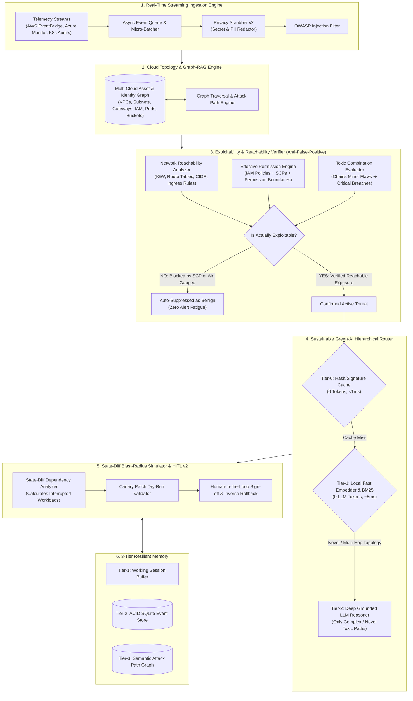

# System Architecture Document — Version 2.0

## Product: CloudSec-RAG v2.0
**Architecture:** Autonomous Graph-RAG, Real-Time Streaming, Reachability Verification & Sustainable Tiered Inference Engine  

---

## 1. High-Level v2.0 Architecture Diagram

---

## 2. Core Subsystems

### 2.1 Exploitability & Reachability Verifier (`cloudsec_rag.v2.verifier`)
Traditional CSPM tools raise alerts based on isolated policy text. v2 verifies whether an adversary can actually access or abuse the asset:
1. **Network Reachability Evaluation:**
   $$\text{IsReachable} = \text{HasInternetGateway}(\text{VPC}) \land \text{RouteToIGW}(\text{Subnet}) \land \text{SecurityGroupAllows}(\text{0.0.0.0/0}, \text{Port})$$
   If the resource is in an air-gapped VPC or internal subnet with only private NAT egress, direct inbound exposure is **disproven**.
2. **Effective Permission Simulation:**
   $$\text{EffectiveAccess} = (\text{ResourcePolicy} \lor \text{IdentityPolicy}) \land \neg \text{ExplicitDeny} \land \neg \text{SCP\_Deny} \land \text{PermissionBoundary}$$
   If an AWS Organization Service Control Policy (SCP) enforces `Deny` on public S3 operations, the bucket is mathematically protected. v2 downgrades or suppresses the finding, eliminating false positives.

### 2.2 Cloud Topology & Toxic Combinations (`cloudsec_rag.v2.graph`)
Models assets as nodes and relationships as edges:
- `InternetGateway` $\xrightarrow{\text{routes\_to}}$ `Subnet` $\xrightarrow{\text{hosts}}$ `Workload` $\xrightarrow{\text{assumes}}$ `IAMRole` $\xrightarrow{\text{reads}}$ `Datastore`
- **Toxic Combination Detection:** An alert with individual severity `LOW` (e.g. EC2 instance profile has read access to an S3 bucket) combined with another `LOW` alert (EC2 instance runs an unpatched web service with port 80 open) escalates into a **CRITICAL Toxic Attack Path** because the chain permits internet-to-datastore exfiltration.

### 2.3 Sustainable Green-AI Routing (`cloudsec_rag.v2.router`)
Instead of dispatching massive LLM calls for every event:
- **Tier-0 (0 Tokens):** Exact hash lookup of known remediations in SQLite/cache (<1ms).
- **Tier-1 (0 LLM Tokens):** Local BM25 + dense semantic subword similarity against CIS benchmark controls (~5ms).
- **Tier-2 (LLM Reasoning):** Only invoked for unmapped, high-ambiguity, or complex toxic combinations.
*Result:* **>80% reduction in token consumption and operating costs.**

### 2.4 State-Diff Blast-Radius Simulator (`cloudsec_rag.v2.simulation`)
Before a patch is executed, the simulator maps:
- **Direct Impact:** The configuration keys being modified.
- **Collateral Impact:** Which microservices, Lambda functions, or external partners currently authenticate or connect to this resource.
- Generates a visual before/after state diff.

### 2.5 Real-Time Event-Driven Streaming Engine (`cloudsec_rag.v2.streaming`)
- Python `asyncio` event queue and consumer worker pools.
- Backpressure control and sliding window micro-batching.
- Capable of streaming real-time alerts from AWS EventBridge, Azure Event Hub, or Kubernetes Admission Webhooks.
